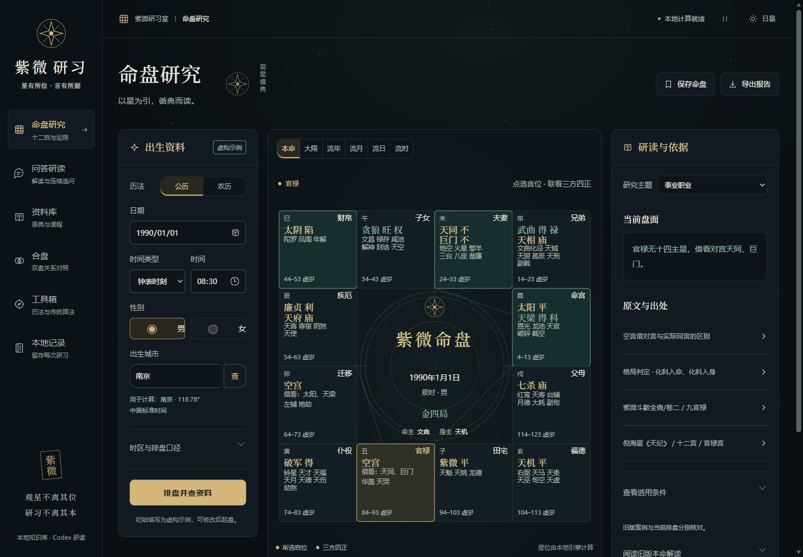
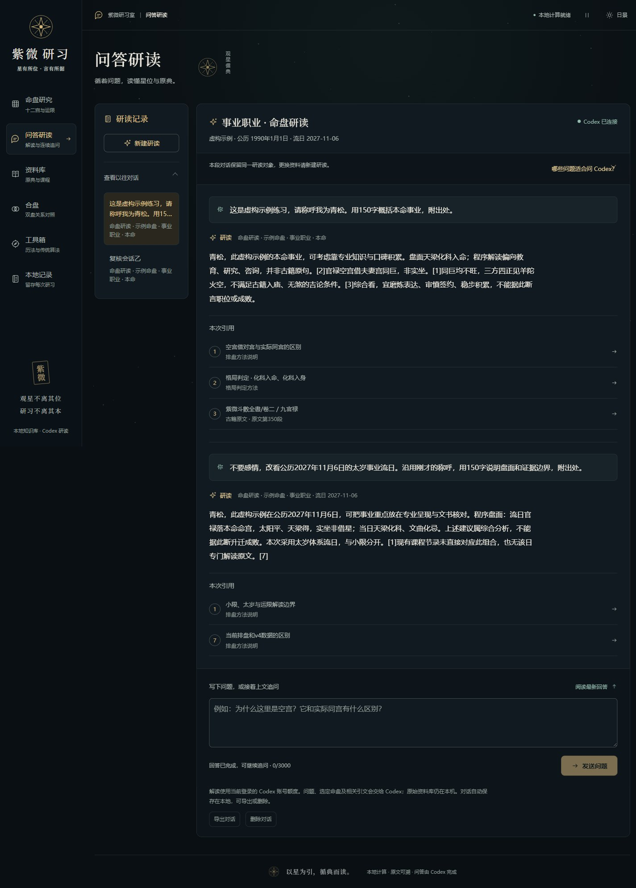

# 紫微研习 · Ziwei Doushu

**可在本机使用的紫微斗数工具、可回查知识库、Codex 搜索技能与网页工作台。**

程序负责历法、排盘、星位与运限计算；知识库提供原文、出处、版本和适用条件；Codex 负责解释、比较与多轮追问。CLI 和技能是完整入口，网页提供“玄金观星台”界面。

Local, source-referenced Ziwei tools and retrieval with a Codex-powered workbench. Windows is the verified platform; Linux/macOS are experimental.

[安装](docs/INSTALLATION.zh-CN.md) · [使用](USAGE.zh-CN.md) · [网页功能](docs/WEB.zh-CN.md) · [知识库构建](docs/KNOWLEDGE_BASE.zh-CN.md) · [第三方依赖与许可](THIRD_PARTY_NOTICES.md) · [维护开发](docs/DEVELOPMENT.zh-CN.md)



## 可以做什么

| 能力 | 本地命令 / 入口 |
|---|---|
| 概念、原话、条件和出处检索 | `ask`、`search`、`source`、`catalog`、`browse`；无需生日 |
| 出生地点、历史时区、公农历、真太阳时与排盘 | `city`、`calendar`、`chart`；钟表小时和时辰序号分别输入 |
| 十三主题、本命/大限/流年/月/日/时 | `context`、`period`、`period-context`、`flights` |
| 感情、合伙、上下级、朋友双盘比较 | `compare`；不伪造网站专属评分 |
| 未知时辰、同盘结构、小六壬 | `time-candidates`、`twins`、`liuren`；候选不等于真实时辰 |
| 旧版本命案例与待核候选资料 | `case`、显式候选检索；完整安装启用 |
| 可直接连续提问 | `chat ask`、`chat get/list/export`；实际调用已登录的 Codex CLI |
| 保存、收藏、备份、导出 | `personal`；HTML、Markdown、SVG、PNG、PDF 报告 |
| 网页六个页面 | 命盘研究、问答研读、资料库、合盘、工具箱、本地记录 |

每项能力都有 CLI/技能入口。`ask`返回证据包，由当前 Codex 对话解释；`chat ask`会另调用 Codex CLI 自动回答。普通排盘、检索、保存和导出不需要聊天模型。

## 快速开始

这是安装在**使用者自己电脑上**的项目。GitHub提供源码和安装文档；每位使用者完成安装、启动自己的服务后，再用浏览器访问自己的本机地址。项目目前没有公共在线演示站点。

**安装使用默认的 `main` 分支即可，其中包含完整功能。** `dependabot/*` 等临时分支是待验证的依赖更新建议，无需切换或分别安装。

先准备 **Python 3.12、Node.js 24+、Git**。PNG/PDF 导出需要 Cairo 和中文字体，Windows 配置见[安装说明](docs/INSTALLATION.zh-CN.md#系统依赖)。GPU 可选；CPU 可以运行嵌入模型。

**完整安装并启动（CPU通用方式）：** 只需先克隆本仓库，下面的安装器会继续获取第三方来源和模型，无需手动逐个克隆。

```powershell
git clone https://github.com/yuguo-Jack/Ziwei_doushu.git
cd Ziwei_doushu
python -X utf8 scripts/bootstrap.py --profile full --device cpu --install-skill
npm install --global @openai/codex
codex login
python -X utf8 ziwei.py doctor --experience
python -X utf8 ziwei.py serve --port 8765
```

已有兼容的Codex CLI可跳过npm安装，已有登录可跳过登录。`doctor --experience`检查完整资料、实际语义检索和排盘、案例、同盘、网页资源、技能绑定及Codex接口/登录；不发起模型回答。检查通过后，保持`serve`运行，在**这台电脑的浏览器地址栏输入**：

```text
http://127.0.0.1:8765/
```

`127.0.0.1`（localhost）始终指浏览器所在的电脑。其他人按上面步骤在自己的电脑安装后，使用同一地址访问自己的实例；服务未启动时，这个地址打不开。保持服务终端开启，按Ctrl+C可停止。

### 完整安装会自动下载哪些内容

| 内容 | 上游来源 | 在本项目中的位置 |
|---|---|---|
| 排盘引擎 | [Renhuai123/ziwei-doushu](https://github.com/Renhuai123/ziwei-doushu)，固定提交`a600484` | `repo/` |
| 天纪课程原文 | [Renhuai123/nihai-tianji-corpus](https://github.com/Renhuai123/nihai-tianji-corpus)，固定提交`462faa4` | `sources/tianji-462faa4/` |
| 人纪课程原文 | [Renhuai123/nihai-renji-corpus](https://github.com/Renhuai123/nihai-renji-corpus)，固定提交`fdafae1` | `sources/renji/` |
| 本地嵌入模型 | [Qwen/Qwen3-Embedding-0.6B](https://huggingface.co/Qwen/Qwen3-Embedding-0.6B)，固定revision`97b0c614…`，约1.21GB | `models/Qwen3-Embedding-0.6B/<revision>/` |
| 77年旧版本命案例 | [ziwei-doushu v4.0-13d发布数据](https://github.com/Renhuai123/ziwei-doushu/releases/tag/v4.0-13d) | 原包在`sources/v4.0-13d/`，建库后在`cases/v4.0-13d/` |

古籍和GeoNames小型固定快照已经随本仓库提供。安装器还会安装Python/Node依赖，构建核心知识库、语义向量、案例候选库、同盘索引和网页，并安装Codex技能。完整固定版本可查[来源清单](config/sources.lock.json)和[模型配置](config/embedding-model.json)；[安装说明](docs/INSTALLATION.zh-CN.md#完整安装自动获取的仓库与模型)列出了各项用途与手动准备项。

Qwen3-Embedding-0.6B负责在本地找资料，回答由Codex生成。上面的完整流程包含两者；**Codex CLI需单独安装，账号由使用者自己登录**。

完整安装建议至少留 **20GB** 空间；首次可能需要数十分钟到数小时。下载与构建会保留已完成阶段，失败后修复原因并重跑同一命令。想先预览自动执行的步骤，可在安装命令末尾加`--dry-run`。

### 可选的较轻安装

想先体验计算、知识检索和网页，可选择较轻安装：

```powershell
python -X utf8 scripts/bootstrap.py --profile core --lexical-only --install-skill
```

此方式不下载嵌入模型，使用关键词检索；**不含旧版案例、案例候选库和同盘索引**。去掉`--lexical-only`即启用语义检索；以后重跑完整安装可补齐资料。`status`和`doctor`会说明已安装范围。

`--dry-run`只显示准备步骤。已有合适的 Python/Node 依赖可分别用`--skip-python-deps`、`--skip-node-deps`；这些选项不会替你验证或修复缺失依赖。

### 接通网页里的 Codex

快速开始已包含[Codex CLI安装和登录](https://developers.openai.com/codex/cli/)。单独排查连接时运行：

```powershell
codex login status
python -X utf8 ziwei.py chat status
```

网页“问答研读”会使用当前账号额度。无需本网站 API Key，无需再下载聊天模型。**Codex 回答需要联网**；问题、选定命盘、相关引文与有限前文会交给模型服务。资料库、索引与嵌入模型留在本机。

首次体验可在网页问“三方四正是什么意思？给出处”，再追问“空宫借星为什么不等于同宫？”，点击引用核对原文。终端也可用`chat ask`实答，详见[首次验收](docs/INSTALLATION.zh-CN.md#完整体验验收)。不同账号的可用模型和额度会影响回答；功能与固定资料可复现，个人记录、聊天历史和逐字回答不随仓库复制。



### 在 Codex 中直接调用技能

安装器会将技能复制到标准技能目录，并在本机绑定当前项目路径。新建一个 Codex 对话后可问：

```text
$ziwei-knowledge-search 三方四正是什么意思？用通俗语言解释，给出处和适用条件。
```

未使用安装器时可单独运行`python -X utf8 scripts/install_skill.py`。技能可从任意工作目录调用，项目搬家后重新安装即可；也可设置`ZIWEI_KB_ROOT`。切换到另一个工作区需要显式`--replace`。

### 直接使用 CLI

```powershell
python -X utf8 ziwei.py search '空宫借星' --limit 5
python -X utf8 ziwei.py source GUIDE-borrow --max-chars 100000
python -X utf8 ziwei.py chart --input-file examples/fictional-first.json
python -X utf8 ziwei.py ask '结合条件研读事业' --input-file examples/fictional-first.json --topic career
python -X utf8 ziwei.py chat ask '150字解释空宫借星，附出处'
```

所有示例出生资料均为虚构。真实使用先核对日期、钟表时刻/时辰、地点、时区与流派参数。详细命令、保存和跨对话追问见[使用手册](USAGE.zh-CN.md)。

## 知识库与数据范围

固定来源基线包括：

- 天纪4,886条原始记录，去重后4,881组；人纪六部课程19,294条原行另域保存。
- 四个古籍电子页、1,818个原段落，保留固定修订、卷章与网站出处。
- 完整安装提供1950–2026共77年的674,976种出生配置、8,774,688个主题；这些是生成的旧版本命存档，**不是实际真人档案**。
- 34,204个城市的GeoNames固定快照、传统算法说明、公开引擎规则和术语。

原文与可执行条件分开保存；检索到某条断语不代表本盘满足。课程未逐条复听、古籍未通校所有刻本，候选材料不进入默认语义索引。具体来源、版本、许可和缺口见[SOURCES.zh-CN.md](SOURCES.zh-CN.md)。

## 项目组织

```text
src/ziwei_kb/       Python工具、检索、会话、网页后端
web/               React网页与固定npm依赖
scripts/           安装、获取固定来源、安装技能、启动/停止
tools/             知识库、案例、向量和同盘构建器及回归检查
tests/             发布与迁移检查
skill/             可安装的Codex技能模板
config/            上游版本、模型、快照校验和Codex设置
design/            数据库schema与界面规范
docs/              安装、功能、构建、架构和维护文档
sources/           小型可分发快照；其它上游由脚本获取
repo/              安装器获取的固定上游引擎（不提交）
knowledge/ cases/ indexes/ models/ manifests/  本机构建结果（不提交）
runtime/ logs/ exports/                     个人数据与运行产物（不提交）
```

本仓库保存源码、构建配方、固定版本清单、许可和必要的小型快照。模型和大型数据库在本地构建，不通过Git传输；无需Git LFS。

## 更新与维护

```powershell
python -X utf8 ziwei.py personal backup
python -X utf8 ziwei.py chat backup
# 停止正在使用本工作区的网页与查询后更新
git pull --ff-only
python -X utf8 scripts/bootstrap.py --profile full --device cpu --install-skill
```

保留原有配置选择；使用GPU或关键词安装时沿用相应参数。安装器按输入指纹复用构建，不会删除模型或个人记录，也不会重置被修改的上游仓库。完整维护、故障排查、测试与发布步骤见[开发维护说明](docs/DEVELOPMENT.zh-CN.md)。

## 许可与范围

项目新增代码使用[MIT](LICENSE)。上游MIT代码、课程CC BY-NC-SA 4.0、案例声明CC BY 4.0及其中引文例外、GeoNames CC BY 4.0、古籍电子版本条款、字体OFL等**分别保留**，详见[第三方说明](THIRD_PARTY_NOTICES.md)。代码MIT不代表所有知识材料可商业使用。

本项目基于[Renhuai123/ziwei-doushu](https://github.com/Renhuai123/ziwei-doushu)及公开语料构建，与收费网站无隶属关系。未恢复其私有评分、闭源专属断语和小限子层，也未取得《紫微斗数全集》可靠完整底本。用于传统文化资料研读；计算和检索验收不等于预测有效性认证。

## 欢迎提需求与反馈

希望这个项目能在大家的实际使用中越做越好。**无论你是否懂代码，都欢迎提需求、报问题，或者告诉我哪里用着不顺手。** 安装步骤、知识库资料、排盘工具、Codex问答和网页体验，都可以聊。

- [我有功能建议](https://github.com/yuguo-Jack/Ziwei_doushu/issues/new?template=feature_request.md)：说说你在什么场景下使用、目前哪里不方便，以及希望达到什么效果。不用先写完整方案，一个具体想法就很有帮助。
- [我遇到了问题](https://github.com/yuguo-Jack/Ziwei_doushu/issues/new?template=bug_report.md)：留下操作步骤、预期结果和实际表现，方便复现和改进。
- [看看已有需求与讨论](https://github.com/yuguo-Jack/Ziwei_doushu/issues)：有相同需求可以补充自己的场景，或点个赞，让维护者了解大家的需要。

文档中的疑惑、资料出处的补充与纠错也很欢迎。你的反馈会帮助确定后续改进方向；愿意参与实现的朋友可参考[贡献说明](CONTRIBUTING.md)。

## 支持项目

如果这个项目对你有帮助，欢迎通过支付宝自愿打赏，支持后续维护、资料整理和体验改进。也欢迎Star、分享给需要的朋友；无论是否打赏，都欢迎继续提需求。

<p align="center">
  <a href="docs/assets/alipay-support.jpg">
    
  </a>
  <br />
  支付宝扫码支持 · 点击图片可查看原图
</p>
