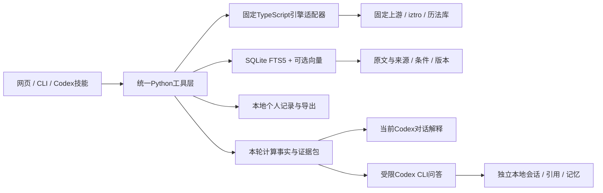

# 架构与目录职责

`src/ziwei_kb/common.py`以源码目录定位工作区，也允许显式`ZIWEI_KB_ROOT`；模型和生成路径相对工作区。该项目采用源码工作区/可编辑安装，单独复制wheel不能替代完整源码、固定引擎和构建结果。

`engine.py`调用`tools/chart_engine.ts`，不运行上游缺私有模块的收费后端。适配层明确支持的公开流派表与层次，拒绝未知字段。

`retrieval.py`先按领域取FTS候选，再可选向量融合，检查来源指纹和行映射。关键词安装明确选择词检索；意外语义失败会披露降级。编码服务按需运行，模型只读取本地固定权重。

`chat_context.py`从固定对象、问题和历史确定本轮主题/时间/关系，重新算事实并取原段；不把未计算层次冒称已计算。`codex_chat.py`负责事务、顺序、幂等、停止/重试隔离和会话持久化。`codex_process.py`通过现有登录启动独立Codex CLI，限制工具并核对结构化回答。

`webapp.py`仅提供本机静态文件与受限JSON动作；React页面通过这些动作使用同一Python函数。网页不是唯一能力入口。

`scripts/bootstrap.py`组织固定输入、依赖、来源、构建、指纹复用和诊断。源码、配置、生成物和个人数据分开，Git仅保存可分发部分。第三方仓库不作为嵌套Git仓库提交，安装时按完整commit获取。
