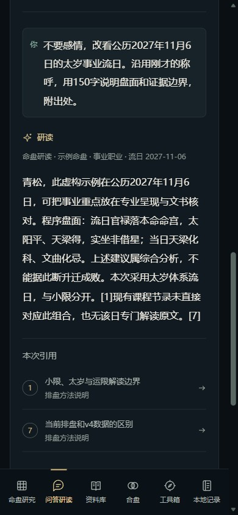

# 网页界面与功能

先完成[安装](INSTALLATION.zh-CN.md)，在使用者自己的电脑运行`python -X utf8 ziwei.py serve --port 8765`，再在同一台电脑的浏览器地址栏输入`http://127.0.0.1:8765/`。这是各自电脑的本机服务地址，服务运行时才可访问；GitHub仓库当前没有公共在线演示站点。

界面为深墨、古金与青玉的“玄金观星台”，可切日景、暂停动效，响应系统减少动态设置；手机使用底部导航。示例资料始终标为虚构。

| 页面 | 操作与结果 | 同等本地入口 |
|---|---|---|
| 命盘研究 | 出生、公农历、钟表/时辰、城市与口径；十二宫、十三主题、本命与运限、三合/飞星/四化 | `chart/context/period/period-context/flights/city/calendar` |
| 问答研读 | Codex回答、连续追问、引用打开、历史、停止、失败重试、导出和删除 | `chat ask/list/get/cancel/retry/export/delete/backup` |
| 资料库 | 分领域检索、课程/古籍书架、卷章筛选、原段/相邻段与时间点 | `search/source/catalog/browse` |
| 合盘 | 甲乙独立输入，感情/合伙/上下级/朋友，真实结构与出处 | `compare` |
| 工具箱 | 同盘、十二时辰假设、历法、小六壬；计算后可发起解读 | `twins/time-candidates/calendar/liuren` |
| 本地记录 | 命盘/收藏/笔记/会话查找、分页、更名、回载与删除 | `personal` |

完整体验请按安装文档运行`full`语义安装、登录自己的Codex账号，再用`doctor --experience`检查。core或关键词方式保留明确的能力差异，界面与CLI范围相同。初次安装使用虚构示例和空白个人记录，不包含作者的聊天历史或浏览器偏好。

## 起盘与研读

1. 核对生日历法、性别、地点与时间类型。上午8点是钟表小时，`hour:8`是申时；已知辰时用时辰序号4。
2. 查城市后点选匹配结果，检查国家、坐标与时区。同名城市不能自动猜选。
3. 点击“排盘并查资料”。修改资料后出现未更新提示，旧盘仍属于上次输入，需重排后发起新对象研读。
4. 查看所选宫位、三方四正与原文。手机可放大命盘或使用逐宫文字。
5. “解读当前命盘”进入已绑定对象的对话；可说“十三主题全盘综述”“不要感情，改看事业”“公历2027年11月6日的太岁流日”。

每段对话固定出生对象/资料，换人或换领域请新建研读；主题与支持的时间可以继续追问。一次先明确一个目标时间，多年份/日期并列比较尚无完整计算，会要求确认或拆问。流月/日/时需要明确日期，流时另需时辰；小限子层不冒充太岁结果。

## 哪些需要LLM

| 内容 | 执行者 |
|---|---|
| 日期、时间、星位、借星、四化、运限、结构和计数 | 本地确定性程序 |
| 搜索原文、条件和出处定位、保存、导出 | 本地数据库、索引和脚本 |
| 白话术语、十三主题综合、原典比较、冲突解释、多轮追问 | Codex读取本轮程序事实和原文后组织回答 |

程序每轮重新准备事实/证据，Codex不能自行使用终端、插件或文件工具修改本项目。回答只允许引用实际提供的编号，正文安全渲染，不展示原始stderr、推理日志、代码或内部配置。

## 历史与个人资料

网页和`chat`共用`runtime/chat.sqlite`，自动保存其研读记录；`personal`保存命盘、收藏及用户明确要求保存的笔记/会话。当前桌面Codex对话不会自动全文写进这两份数据库。

问答会使用账号额度，问题、选定出生输入、相关引文与有限前文会发送给Codex当前模型服务；不上传整个知识库。模型服务联网，计算与原文检索可离线使用。对话可导出/删除，两份库分别备份。

## 导出

报告输出HTML/Markdown/SVG/PNG/PDF，保存在`exports/`；屏幕深色主题不影响白底打印版本。要把当前Codex解释加入完整报告，先保存为Markdown，再用CLI的`report --analysis-file`。网页对话的“导出对话”单独生成会话Markdown。

`--hide-birth`隐藏显式生日/出生键，不等于不可反推的匿名化。导出文件可能含个人资料，不提交Git。

